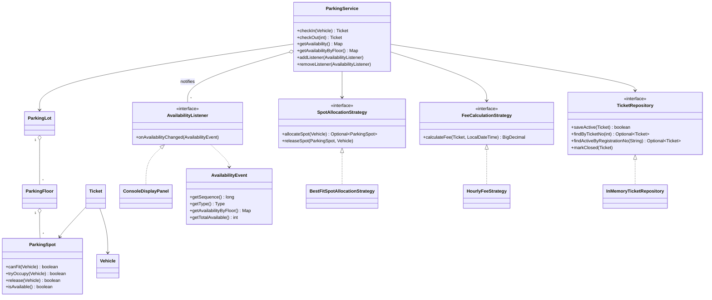
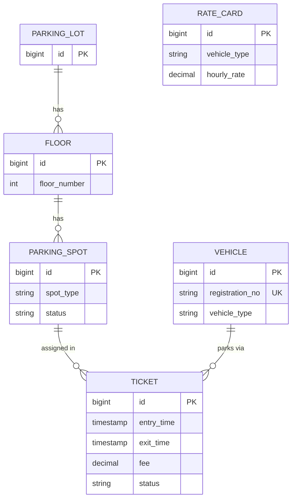

# Smart Parking Lot: Low-Level Design

## 1. Scope
Plain Java (Java 8), in-memory, console demo. No Spring Boot or REST layer, because the brief asks for a
low-level design. The database schema is a design deliverable (`schema.sql`); the code uses repository
interfaces with an in-memory implementation that map onto it. Patterns used: Strategy (allocation and fee),
Observer (availability display) and Repository (ticket storage).

## 2. Class diagram


## 3. Data model


| Code | Table | Note |
|---|---|---|
| `ParkingLot` | `parking_lot` | |
| `ParkingFloor` | `floor` | |
| `ParkingSpot` | `parking_spot` | The occupant (`AtomicReference<Vehicle>`) is the `status` column plus the active ticket |
| `Vehicle` | `vehicle` | |
| `Ticket` | `ticket` | Fee is stored at exit, so later rate changes don't alter history |
| rates map in `HourlyFeeStrategy` | `rate_card` | |
| `putIfAbsent` in `InMemoryTicketRepository` | `uq_ticket_active_vehicle` | one active ticket per vehicle |
| free-spot index + `tryOccupy` | `FOR UPDATE SKIP LOCKED` + `uq_ticket_active_spot` | one active ticket per spot |

## 4. Spot allocation algorithm
- **Sizes:** BIKE needs SMALL, CAR needs MEDIUM, BUS needs LARGE. A vehicle may use a larger spot
  (fallback), preferring the smallest that fits so large spots are not wasted.
- **Index:** one sorted set of FREE spots per spot type, ordered by (floor, spot id), so the lowest
  floor wins within a type.
- **Allocate:** starting at the vehicle's minimum type, `pollFirst()` from that type's set; if it is empty,
  try the next larger type. `pollFirst()` is atomic, so no two threads receive the same spot.
  Cost: O(T x log n), where T = 3 spot types and n = free spots of a type.
- **Release:** the spot is freed, and only if that actually freed it is it added back to the set.
- **Invariant:** a spot is in the index only while it is free.
- **DB equivalent:**
```sql
SELECT s.id
FROM parking_spot s
JOIN floor f ON f.id = s.floor_id
WHERE s.status = 'AVAILABLE'
  AND s.spot_type IN (:fittingTypes)          -- e.g. CAR -> ('MEDIUM', 'LARGE')
ORDER BY CASE s.spot_type WHEN 'SMALL' THEN 1 WHEN 'MEDIUM' THEN 2 ELSE 3 END,
         f.floor_number, s.id
LIMIT 1
FOR UPDATE SKIP LOCKED;
```

## 5. Check-in and check-out
**Check-in**
1. Reject if the vehicle already has an active ticket.
2. Reserve a spot through the allocation strategy; none left means `NoSpotAvailableException`.
3. Create the ticket (arrival time from an injected `Clock`) and save it atomically.
4. If saving fails or the vehicle lost a race, release the spot (rollback) and publish
   `RESERVATION_CANCELLED`.
5. On success, publish `VEHICLE_PARKED` to the display listeners.

**Check-out**
1. Find the ticket; unknown means `TicketNotFoundException`, already closed means `TicketAlreadyClosedException`.
2. Exit time comes from the clock. Fee is calculated before any state changes.
3. `Ticket.close(exitTime, fee)` records both. It is synchronized and returns false if already closed,
   so only one concurrent checkout wins.
4. Remove the ticket from the active index, then release the spot.
5. Publish `VEHICLE_EXITED` to the display listeners.

## 6. Fee calculation
Fee = hourly rate of the vehicle type x hours parked. Hours are rounded up with a minimum of 1,
computed from seconds (1h 00m 30s bills as 2 hours). The rate depends on the vehicle type, not the spot
type, so a car in a LARGE spot pays the car rate. Money is `BigDecimal`.

## 7. Concurrency
| Risk | Handling |
|---|---|
| Two vehicles get the same spot | Atomic `pollFirst()` from the free index plus `tryOccupy` (compare-and-set) |
| Same vehicle parked twice | `putIfAbsent` in the repository; the loser releases its spot |
| Same ticket charged or freed twice | `Ticket.close` is synchronized and idempotent; the spot is released only for the winner |
| A stale release frees someone else's spot | `release(vehicle)` is a compare-and-set against the exact occupant |
| Lost or duplicated spot in the index | Add to the index only when `release` returned true; the set ignores duplicates |
| Display shows stale or out-of-order data | Notifications are serialized under a lock with sequence numbers; each snapshot is taken after the previous one |

No global lock on the parking path; contention is per spot. Verified by the demo: 20 cars racing for
5 spots, the same vehicle from 10 threads, the same ticket checked out from 10 threads, and 16 threads
cycling check-in and check-out for 8,000 attempts, followed by a check that the index still holds exactly
the right spots. For the display: 8 threads produced 2,496 events that arrived in order with no gaps, the
last event matched the real final state, and a listener that throws did not break parking or the other
listeners.

## 8. Real-time availability (Observer pattern)
- **Pull:** `getAvailability()` and `getAvailabilityByFloor()` read live spot state on demand, so they
  cannot drift from reality. They are O(spots) reads, which is fine for reporting and is not on the
  check-in path.
- **Push:** `ParkingService` is the subject. Observers implement `AvailabilityListener` and register with
  `addListener`. After each successful check-in, check-out, or rolled-back reservation, the service builds an
  `AvailabilityEvent` (type, vehicle, spot, sequence number, per-floor snapshot) and delivers it to every
  listener. `ConsoleDisplayPanel` is the entrance display board.
- **Ordering:** delivery runs under one lock, so events arrive one at a time in sequence order, and every
  snapshot is taken after the previous one. The last event a listener sees therefore always equals the final
  real state.
- **Rollbacks:** a check-in that is rolled back publishes `RESERVATION_CANCELLED`, so a display that briefly
  saw the reserved spot is corrected.
- **Fault isolation:** a listener that throws is logged and skipped; it cannot break parking or other
  listeners.
- **No listeners, no cost:** with nothing registered, publishing returns immediately.
- **Trade-off:** listeners run on the caller's thread, so a slow listener delays the next notification.
  Slow consumers (email, network) should hand events to their own queue.

## 9. Known limitations
- The free-spot index is built once from the lot, so build the whole lot before creating the strategy.
- A check-in can briefly see "full" while another thread's check-in is about to roll back and free its spot.
- Tickets and vehicles are in memory only, and ticket numbers restart on every run.
- Fees use the rate in the strategy at exit time; there is no payment step.
- Persistence is a design-only deliverable (`schema.sql`); swapping `InMemoryTicketRepository` for a
  JDBC/JPA one is the intended extension point.
- Listener callbacks run synchronously on the thread that performed the check-in or check-out.
- A listener sees every event from the moment it subscribes; there is no replay of earlier events.